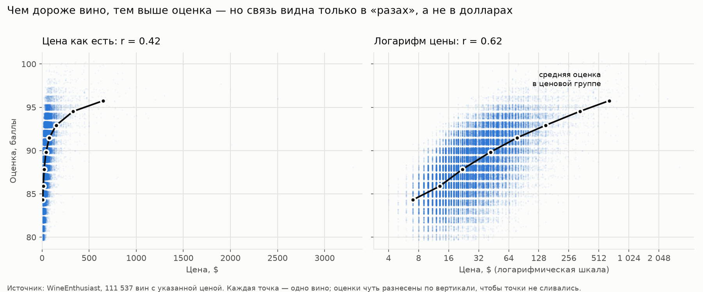

# Wine Analytics: от чего зависит оценка вина

Пет-проект по анализу данных: 130 тысяч отзывов о вине от критиков журнала WineEnthusiast.
Проверяю гипотезы о том, как цена, регион, возраст, сорт и критик связаны с оценкой и ценой вина.

**Цель:** понять, от чего зависят оценка и цена вина, и сформулировать рекомендации для покупателя.

## Главные выводы

| № | Гипотеза | Результат | Ключевые цифры |
|---|---|---|---|
| 01 | Связь между ценой и оценкой слабая | не подтвердилась | r = 0.42, на логарифме цены r = 0.62 |
| 02 | Связь между регионом и ценой сильная | не подтвердилась | r = 0.28, на логарифме цены r = 0.44 |
| 03 | Чем старше вино, тем выше оценка | не подтвердилась | r = −0.05 |
| 04 | Известные сорта (Pinot Noir, Cabernet Sauvignon, Chardonnay) — в топе по оценкам | частично | в топ-10 только Pinot Noir |
| 05 | Разные критики оценивают с разной строгостью | подтвердилась | средние оценки критиков от 85.8 до 90.6 |

Шкала для корреляции: до 0.3 — слабая связь, 0.3–0.7 — умеренная, больше 0.7 — сильная.

### 01. Цена и оценка — [SQL](sql/analysis/01_price_vs_points.sql)

- Связь умеренная, а не слабая: r = 0.62 на логарифме цены. Цена объясняет около 38% разброса оценок (0.62² ≈ 0.38).
- Среди вин до $15 оценку 90+ получают 3.4%, среди вин за $100+ — 89%.
- Связь видна «в разах», а не в долларах: на обычной шкале несколько очень дорогих вин растягивают ось, и корреляция ниже (0.42).



### 02. Регион и цена — [SQL](sql/analysis/02_region_vs_price.sql)

- Связь слабая (r = 0.28), на логарифме цены умеренная (r = 0.44), но не сильная.
- Регион объясняет около 19% разброса цен, остальное зависит от других факторов.
- Регион — это текст, поэтому связь считается так: каждому вину ставится средняя цена его региона, и считается корреляция между ценой вина и средней ценой региона.

### 03. Возраст и оценка — [SQL](sql/analysis/03_age_vs_points.sql)

- Связи практически нет: r = −0.05. Средняя оценка вин в возрасте до 20 лет почти одинаковая — 88.2–88.9.
- Вина старше 20 лет оценены выше (89.8), но их всего 224, и они в среднем дорогие ($101) — высокая оценка может объясняться ценой, а не возрастом.

### 04. Сорта — [SQL](sql/analysis/04_variety_vs_points.sql)

- Из трёх известных сортов в топ-10 попал только Pinot Noir (8-е место, 89.4). Cabernet Sauvignon (88.6) и Chardonnay (88.3) в топ-10 не вошли.
- В топе есть и недорогие сорта: Grüner Veltliner ($28), Blaufränkisch и Riesling ($33) оценены выше, чем Cabernet Sauvignon ($48).

### 05. Критики — [SQL](sql/analysis/05_critics_vs_points.sql)

- Средние оценки у критиков различаются почти на 5 баллов: от 85.8 до 90.6.
- Но каждый критик в основном оценивает вина своих стран, поэтому честнее сравнивать критиков внутри одного региона. Там разница меньше, но остаётся: в Эльзасе Anne Krebiehl MW ставит в среднем на 2.6 балла больше, чем Roger Voss.
- Различаются не все критики: в штате Вашингтон Paul Gregutt и Sean P. Sullivan оценивают почти одинаково (89.1 и 88.9).

## Рекомендации покупателю

1. **Цена — хороший ориентир, но не гарантия.** Чем дороже вино, тем выше шанс высокой оценки, но цена объясняет только около 38% разброса оценок — хорошие недорогие вина встречаются.
2. **Не переплачивать за возраст.** Оценка вин в возрасте до 20 лет от возраста почти не зависит.
3. **Присмотреться к недорогим сортам с высокими оценками:** Grüner Veltliner, Blaufränkisch, Riesling (с оговоркой из раздела «Что можно улучшить»).
4. **Учитывать, кто ставил оценку.** Даже в одном регионе разные критики ставят в среднем до 2.6 балла разницы.

## Данные

- Источник: датасет [Wine Reviews](https://www.kaggle.com/datasets/zynicide/wine-reviews) на Kaggle — отзывы журнала WineEnthusiast, собранные в 2017 году.
- 129 971 отзыв: страна, регион, сорт, винодельня, цена, оценка (от 80 до 100 баллов), имя критика и текст отзыва.
- Лицензия датасета — CC BY-NC-SA 4.0, поэтому сами данные в репозитории не хранятся: их нужно скачать (см. «Как запустить»).

## Как устроен проект

1. **Осмотр данных** — [`explore.py`](src/wine_analytics/data/explore.py): размер таблицы, типы колонок, пропуски.
2. **Очистка** — [`clean.py`](src/wine_analytics/data/clean.py):
   - удалены строки без страны, региона или сорта (64 строки);
   - неразрывные пробелы в текстах заменены на обычные: из-за них, например, запрос `WHERE taster_name = 'Anne Krebiehl MW'` ничего не находил;
   - удалены полные дубликаты (9 979 строк);
   - из названия вина извлечён год урожая: берётся самый поздний год вида 19xx/20xx, потому что в названии бывает и год основания винодельни («Hazlitt 1852 Vineyards 2007»); годы вне 1900–2017 считаются пустыми;
   - в итоге 119 928 вин.
3. **Проверка годов урожая** — [`check_vintage.py`](src/wine_analytics/data/check_vintage.py).
4. **Загрузка в PostgreSQL** — [`load_to_postgres.py`](src/wine_analytics/database/load_to_postgres.py): таблица `wines`, колонка `id` — первичный ключ.
5. **Анализ** — SQL-файлы в [`sql/analysis/`](sql/analysis/): в каждом гипотеза, запросы, результат и вывод.
6. **Визуализация** — [`price_vs_points.py`](src/wine_analytics/viz/price_vs_points.py): график связи цены и оценки.

## Стек и методы

- **Python 3.14:** pandas, NumPy, matplotlib, SQLAlchemy, psycopg, python-dotenv
- **PostgreSQL 18**, pgAdmin
- **SQL:** агрегатные функции, `GROUP BY` / `HAVING`, `CASE`, оконные функции (`OVER (PARTITION BY ...)`), `CORR`
- **Статистика:** корреляция Пирсона, логарифмирование скошенных данных, сравнение средних по группам

## Структура репозитория

```
wine-analytics/
├── data/                      # данные, не хранятся в git
│   ├── raw/                   # исходный CSV с Kaggle
│   └── processed/             # очищенные данные
├── reports/figures/           # графики
├── sql/analysis/              # анализ: гипотезы, SQL-запросы, выводы
├── src/wine_analytics/
│   ├── data/                  # осмотр и очистка данных
│   ├── database/              # загрузка в PostgreSQL
│   └── viz/                   # графики
├── requirements.txt
└── README.md
```

## Как запустить

1. Клонировать репозиторий:
   ```bash
   git clone https://github.com/ivan-yudin-2000/wine-analytics.git
   cd wine-analytics
   ```
2. Скачать датасет с [Kaggle](https://www.kaggle.com/datasets/zynicide/wine-reviews) и положить файл `winemag-data-130k-v2.csv` в папку `data/raw/`.
3. Создать виртуальное окружение и установить зависимости (Windows):
   ```bash
   python -m venv .venv
   .venv\Scripts\activate
   pip install -r requirements.txt
   ```
   На macOS и Linux окружение активируется командой `source .venv/bin/activate`.
4. Создать в PostgreSQL базу `wine_analytics` и файл `.env` в корне проекта:
   ```
   DB_HOST=localhost
   DB_PORT=5432
   DB_NAME=wine_analytics
   DB_USER=postgres
   DB_PASSWORD=ваш_пароль
   ```
5. Очистить данные и загрузить их в базу:
   ```bash
   python src/wine_analytics/data/clean.py
   python src/wine_analytics/database/load_to_postgres.py
   ```
6. Выполнить запросы из `sql/analysis/` в pgAdmin или psql и построить график:
   ```bash
   python src/wine_analytics/viz/price_vs_points.py
   ```

## Ограничения

- В датасете только вина с оценкой от 80 баллов, поэтому связь оценки с другими факторами может быть занижена.
- Нет даты дегустации, поэтому возраст вина считается на 2017 год, а не на момент оценки.
- В колонке `variety` кроме сортов есть купажи и стили (Champagne Blend, Port), а один сорт иногда записан под разными названиями (Syrah и Shiraz).
- У 21% отзывов не указано имя критика, а каждый критик в основном оценивает вина своих стран.

## Что можно улучшить

- Проверить, насколько высокие места австрийских сортов (анализ 04) связаны с тем, что их чаще оценивал самый щедрый критик (анализ 05).
- Объединить разные названия одного сорта (Syrah и Shiraz, Grenache и Garnacha, Pinot Gris и Pinot Grigio).
- Сделать интерактивный дашборд на Streamlit.
